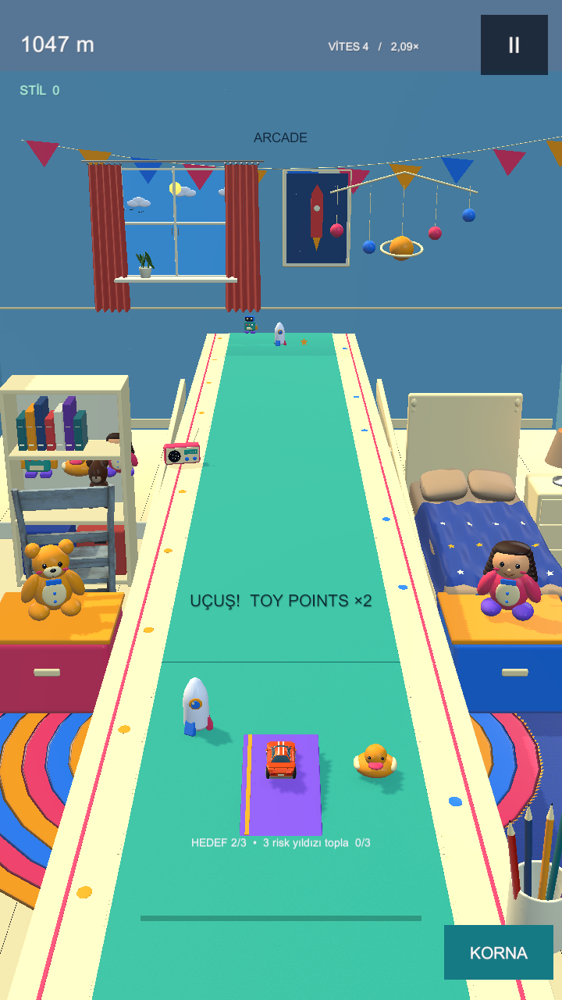

# BRAKE TOY

**NO BRAKES. BIG TROUBLE.** Unity 6.3 LTS / C# / gerçek 3D URP / Android portre.

## v0.7 — Joyful Room revizyonu

Menü ve yarış için ayrı müzik, gerçek oyuncak sesleri, erken hızlanan parkur, gelişen falsolu çoklu toplar, hareketli oyuncak otobüs ve yeşil oklu kitap rampaları/havada 2x TP. Yeni renkli oda; radyo/oyuncaklar, daha geniş kadraj ve gün/gece döngüsü. Film kalitesi veya kullanıcı kabulü tamamlandı demek değildir.

[Android APK / v0.7.0](https://github.com/brscncn1/Brake-Toy/releases/tag/v0.7.0) · [Kaynak dalı](https://github.com/brscncn1/Brake-Toy/tree/feat/joyful-room-v07) · [Notion](https://app.notion.com/p/3ffdce66583181868ac1d4e4bd6feeac)

## Aç ve oyna

1. `feat/joyful-room-v07` dalını Unity **6000.3.26f1** ile aç. Tools → Brake Toy → **Open Joyful Room v0.7** → Play. Game görünümü 9:16, 1×.
2. Parmağı/mouse'u sürükle. Yeşil ok kitap rampasını gösterir; havada kazanılan TP bölümü 2x. Motor, efekt ve müzik ayrı ayarlanır.
3. APK önceki oyunun üzerine güncellenir; paket com.braketoy.prototype, 0.7.0/kod7, ARM64 IL2CPP, non-Development test APK. Mağaza imzası değildir.
4. TP ve açık araçlar korunur; v0.7 rekorları/ghost yeni kurallarla ayrıdır. [El kitabı](PLAYER_GUIDE.md).

## Doğrulama ve belgeler

**87/87 Unity testi** (44 EditMode +43 PlayMode) geçti. [Sonuç/eleştiri/cihaz kabulü](MILESTONE-v07.md), [gerçek motor galerisi](JOYFUL_GALLERY.html), [plan](PLAN-v0.7.md), [araştırma](RESEARCH-v0.7.md), [ses lisansları](THIRD_PARTY_ASSETS.md). 16 Joyful renderı ve Tests/*-v07.xml korunur.

Fiziksel v0.7 FPS/p95/ısınma ve insan ses/görsel kabulü bekler. Canlı online kurulmadı; yeni joyful-r2, eski review-r1 referans sunucuya skor göndermez. Eski sunucu kodu ve v0.6 raporları geçmiş kanıt olarak korunur. [Servis sınırı](Server/README.md).

10 araç/3D garaj, kariyer, görev/başarım, Relax, günlük yerel antrenman ve kişisel ghost sürer. [Tasarım](GAME_DESIGN.md), [mimari](ARCHITECTURE.md), [yol haritası](ROADMAP.md), [günlük](DEV_LOG.md), ANDROID_BUILD_REPORT-v07.json ve MODEL_VALIDATION-v07.json.
