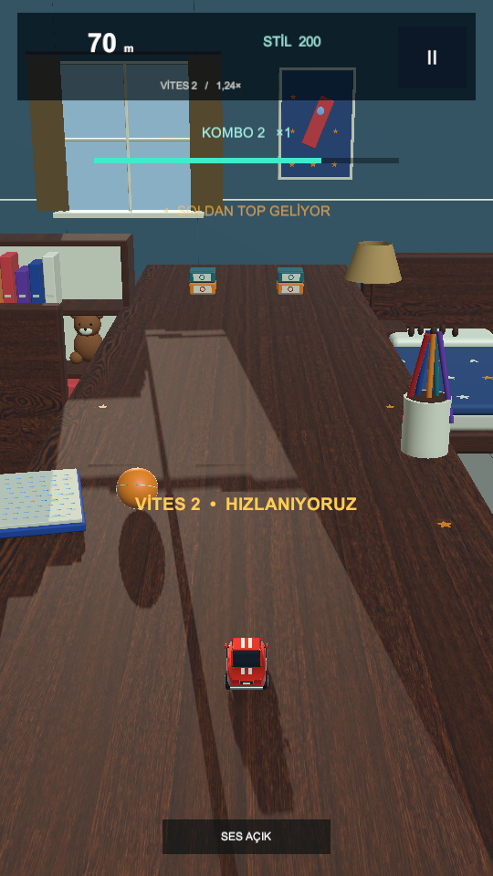

# BRAKE TOY

**NO BRAKES. BIG TROUBLE.** Unity 6.3 LTS / C# / gerçek 3D URP / Android portre.

## v0.3 — Arcade Workshop

İlk saniyelerde başlayan kaçışlar, yumuşak hız artışı, seed'li engel dizileri, uyarılı yuvarlanan toplar, Near Miss/kombo/Fever, mesafe/stil rekoru ve yeniden modellenmiş oyuncak araba. Pencere ışığı, kumaş perde/abajur, gerçek ahşap doku ve ayrı boya/cam/metal/kauçuk malzemeleri.

Bu görüntü gerçek çalışan Unity sahnesinden alınmıştır. Concepts klasöründeki onaylanmış AI konsepti ayrı bir hedef görseldir; mevcut sürüm final sanat kalitesi olarak sunulmaz.

## Aç ve oyna

1. Unity Hub → Add project from disk → bu klasör. Unity 6000.3.26f1.
2. Tools → Brake Toy → Open Arcade Workshop v0.3.
3. Game oranı **16:9 Portrait (9:16)**, Scale 1×. Play → OYNA.
4. Fareyi basılı tutup sağa/sola sürükle; telefonda parmakla sürükle. Alt ortadan ses kapatılabilir.

[Android APK / sürüm](https://github.com/brscncn1/Brake-Toy/releases/tag/v0.3.0) · [v0.3 kaynak dalı](https://github.com/brscncn1/Brake-Toy/tree/feat/arcade-workshop-v03) · [Notion proje merkezi](https://app.notion.com/p/3ffdce66583181868ac1d4e4bd6feeac)

APK ARM64 IL2CPP Development, Android 7.1+; yerelde Builds/Android/BrakeToy-v0.3-Arcade.apk. APK'lar kaynak Git geçmişi yerine Releases içinde. Eski ToyRoom ve ToyRoomTabletop sahneleri ve sürümleri korunur.

## DoÄŸrulama ve belgeler

**41/41 Unity testi geçti**: 26 EditMode + 15 PlayMode. 128.000 satır koridor kontrolü, 10.000 top çarpışma örneği, 2 dakikalık motor içi tanık sürüşü, pause/retry, Near Miss, Fever ve model/kamera kontrolleri. APK imza/paket kontrolü geçti. Fiziksel cihaz FPS/ısı/dokunma ve insan oynanış dengesi henüz doğrulanmadı.

- ARCADE_MILESTONE.md — bu sürümün deneyimi ve sınırları.
- RESEARCH-v0.3.md — benzer oyun araştırması, kaynaklar ve uygulama kararları.
- THIRD_PARTY_ASSETS.md — CC0 doku kaynağı, lisansı ve dosya özetleri.
- TEST_REPORT.md, UNITY_TEST_RESULTS.json, Tests/*.xml, ANDROID_BUILD_REPORT.json — gerçek kanıtlar.
- GAME_DESIGN.md, ARCHITECTURE.md, ROADMAP.md, SOURCE_REQUIREMENTS.md — tasarım/kapsam.
- DEV_LOG.md ve Notion — aktif geliştirme karar ve test günlüğü.
- Models-v0.3-*.png — gerçek motor içinde model yakın planları.

Kayıtlı tam kapsam için yayın hazırlığı Faz 6. Bu ara sürüm tüm Faz 2/3 veya oyunun finali değildir. Notion ücretsiz blok sınırı ek süresi 24 Ekim 2026 00.41 İstanbul'da biter; yazma engellenirse yerel günlük korunup eşitleme bekleyenler kaydedilecek.
