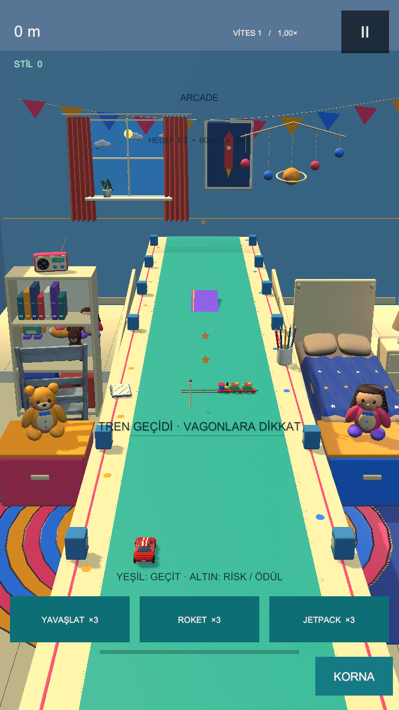
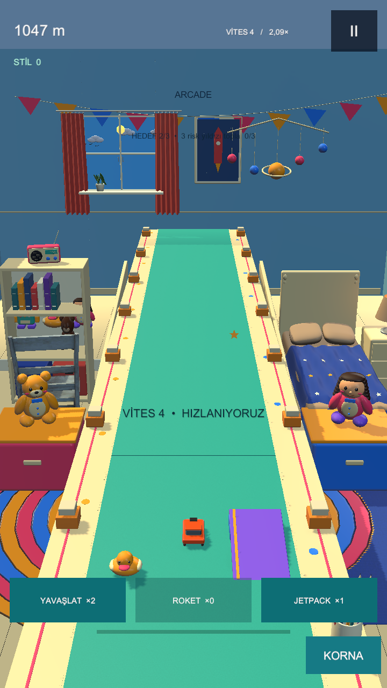
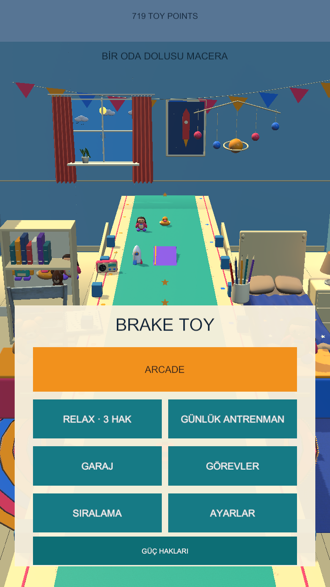

# BRAKE TOY

25 Ekim K2.1: [ilk dakika tempo ölçümü](Docs/OPENING_PACE-2026-10-25.md),
[10/30/60 saniye motor görüntüleri](Reports/Visuals/OPENING_GALLERY.html).
149/149 Unity testi; hız/parkur kuralları değişmedi, yeni APK üretilmedi.

25 Ekim K1.2: [temiz GitHub klonu doğrulandı](Docs/CLEAN_CLONE-2026-10-25.md),
145/145 Unity testi; bağımsız C# 19/19 ve sunucu 9/9 ayrıca geçti. Yeni APK üretilmedi.

25 Ekim K1.6/K1.7: [açık Android profilleri](Docs/ANDROID_BUILD_PROFILES.md), 74/74 Editor testi.
Dal `fix/explicit-android-build-target`; APK üretmeden hedef doğrulaması eklendi.

25 Ekim K1.5: [iniş ve rampa sınırları](Docs/LANDING-2026-10-25.md), 124/124 Unity testi.
Dal `fix/landing-ramp-boundaries`; indirmedeki APK bu yeni düzeltmeleri henüz içermez.

25 Ekim sağlamlaştırma: [Relax toparlanması ve kayıt geçişi](Docs/HARDENING-2026-10-25.md),
53 EditMode +66 PlayMode =119/119. Dal `fix/adventure-relax-records`; yeni APK henüz üretilmedi.

25 Ekim düzenlemesi: sürüm/test/build kanıtları [Reports](Reports/README.md),
galeriler `Reports/Visuals`, eski plan ve kilometre taşları
[Docs/Archive/pre-v09](Docs/Archive/pre-v09/README.md) altında tutulur.
Bu düzenlemenin dalı `chore/project-organization`; oyun sürümü v0.9.0 olarak kalır.

**NO BRAKES. BIG TROUBLE.** Unity 6.3 LTS / C# / gerçek 3D URP / Android portre.

## Agent belgeleri — 24 Ekim 2026

Codex ve Claude Code için ortak giriş [AGENTS.md](AGENTS.md); [yol haritası](YOL_HARITASI.md), [mimari](MIMARI.md), [mekanikler](MEKANIKLER.md). Yardımcılar: [Claude](CLAUDE.md), [kararlar](KARARLAR.md), [doğrulama](DOGRULAMA.md). Her dosya en fazla 300 satırdır; konuya göre okunur. Güncel belge dalı **docs/agent-handbook**, oyun tabanı v0.9 Adventure. Eski İngilizce/faz belgeleri tarihsel kayıttır. Notion merkez ve mevcut belge özetleri/kaynak bağlantıları güncellendi; yeni tam sayfa kopyaları ücretsiz blok kotası nedeniyle bekliyor ([eşitleme kapsamı](Docs/NOTION_SYNC-agent-handbook.json)). Belge turunda oyun kodu/APK değişmedi, Unity testleri yeniden koşulmadı.

## v0.9 — Adventure

**Sekiz yeni parkur mekaniği:** iki çıkışlı karton tünel, kurmalı kurbağa/ördek, sallanan oyuncak vinç, enine oyuncak tren, 1–3 misketli oluk, yapışkan bant/kaygan kartlar, cetvel tahterevalli ve kapısından araç çıkan oyuncak garaj.

Sekizli karıştırılmış seçim, son üç aileyi tekrarlamama, bağlı yaklaşma/karar/atlayış dizileri ve açık yeşil yol. Hız eğrisi korunur; yüzey ve zamanlama kararları yenidir. Tidy yerleşimi, raf radyosu, müzik ve TP/araç/güç envanteri korunur. Domino yoktur.

[APK v0.9.0](https://github.com/brscncn1/Brake-Toy/releases/tag/v0.9.0) · [Kaynak feat/adventure-v09](https://github.com/brscncn1/Brake-Toy/tree/feat/adventure-v09) · [Sonuç/kanıt](Reports/MILESTONE-v09.md) · [13 gerçek Unity görüntüsü](Reports/Visuals/ADVENTURE_GALLERY.html)

Unity **6000.3.26f1** → Tools → Brake Toy → **Open Adventure v0.9** → Play. Game 9:16, 1×. Paket com.braketoy.prototype, **0.9.0/kod10**, ARM64 IL2CPP non-Development; öncekinin üzerine güncellenir. Kariyer aynı dosyada, yeni parkurun rekor/ghost kayıtları ayrıdır. **112/112 test: 50 EditMode +62 PlayMode.** Fiziksel tablet ve insan görsel/oynanış kabulü bekler. Notion yeni not eşitlemesi ücretsiz blok kotası nedeniyle bekler; yerel/GitHub günlükleri günceldir.

Aşağıdaki v0.8.1 ve önceki bölümler tarihsel teslim kayıtlarıdır; güncel oyun Adventure sahnesidir.

## v0.8.1 — Yerleşim düzeltmesi arşivi

Mavi kenar dekorları defter/kalemlikten ayrıldı, radyo soldaki rafın üstüne taşındı, domino aktif oyundan kaldırıldı. Hız/zorluk ayarları korunur. Önceki kariyer/TP/araç/güç hakları sürer.

[APK v0.8.1](https://github.com/brscncn1/Brake-Toy/releases/tag/v0.8.1) · [v0.8.1 kaynak](https://github.com/brscncn1/Brake-Toy/tree/fix/table-layout-v081) · [104/104 test ve sonuç](Docs/Archive/pre-v09/MILESTONE-v081.md)

Unity 6000.3.26f1 → Tools → Brake Toy → **Open Tidy Room v0.8.1** → Play. Paket com.braketoy.prototype, 0.8.1/kod9; APK öncekinin üzerine güncellenir. Önceki v0.8 açıklamaları aşağıda tarihsel olarak korunur; bu sürümün sahnesi Tidy'dir.

## v0.8 — Playground

Güvenli/riskli yollar, bağlı karşılaşmalar, kitap rampalarının teker kenarı düzeltmesi, domino ile yol açma ve sinyalli oyuncak kapısı. 3 sn yavaşlatma, korumalı roket ve 5 sn jetpack; başlangıçta üçer hak, TP yenileme. Geri alınabilir masa bölgeleri, ışık/malzeme düzenlemesi, kompakt menü, görsel görev kartları ve ayrı araç siluetleri. Ayrıntılı final model/sanat kabulü bekler.

[APK v0.8.0](https://github.com/brscncn1/Brake-Toy/releases/tag/v0.8.0) · [Kaynak](https://github.com/brscncn1/Brake-Toy/tree/feat/playground-v08) · [Ayrıntılı sonuç/eleştiri](Docs/Archive/pre-v09/MILESTONE-v08.md)

## v0.8 arşivi: Aç ve oyna

1. feat/playground-v08 dalını Unity **6000.3.26f1** ile aç. Tools → Brake Toy → **Open Playground v0.8** → Play. Game 9:16, 1×.
2. Sürükle; yeşil rota güvenli, altın rota isteğe bağlı risk/ödül. Kitap rampasındaki yeşil yaklaşma oku atlayışı gösterir. Havada kazanılan TP bölümü 2x.
3. Üç güç düğmesi sürüşte; aynı anda bir güç. Haklar kalıcıdır, retry yenilemez. Menü → GÜÇ HAKLARI: 350/500/650 TP. Gerçek para/coin yok.
4. Ayarlar → MASA: KLASİK / DOMİNO: KAPALI; iki deney ayrı geri alınabilir. Eski v0.7 sahnesi ayrıca korunur.
5. APK öncekinin üzerine güncellenir: com.braketoy.prototype, 0.8.0/kod8, ARM64 IL2CPP non-Development test paketi; mağaza imzası değildir. TP/açık araçlar taşınır, yeni rekor/kariyer/ghost ayrıdır. Güç kullanılan turda ghost yazılmaz.

## v0.8 arşivi: Kanıt ve belgeler

**102/102 Unity testi** (48 EditMode +54 PlayMode).

[Gerçek görüntüler](Reports/Visuals/PLAYGROUND_GALLERY.html), [plan](Docs/Archive/pre-v09/PLAN-v0.8.md), [model agent devir notu](MODEL_HANDOFF-v08.md), [tasarım](Docs/Archive/pre-v09/GAME_DESIGN.md), [mimari](Docs/Archive/pre-v09/ARCHITECTURE.md), [günlük](DEV_LOG.md). ANDROID_BUILD_REPORT-v08.json, UNITY_TEST_RESULTS-v08.json ve MODEL_VALIDATION-v08.json.

Fiziksel v0.8 FPS/p95/ısınma ve insan kalite kabulü bekler. Canlı online kapalı; yeni kurallar eski referans sunucuya gönderilmez. Notion mevcut proje merkezi korunur, ücretsiz blok sınırı yeni sayfayı reddetti: [eşitleme durumu](NOTION_PENDING-v08.md). Müzik ve önceki sürüm kanıtları korunur.
